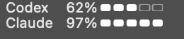

# AgentBar

**Codex와 Claude Code의 주간 잔여량을 두 줄로 보여주는 macOS 메뉴바 앱.**



*예시 데이터입니다. 위: Codex / 아래: Claude.*

- 이름 · 잔여 % · 막대를 고정된 열에 정렬합니다. 숫자 자릿수가 바뀌어도 간격을 유지합니다.
- 주간 막대의 `W`를 생략하고 macOS 기본 단색으로 표시합니다.
- 상세 화면의 기본 색상과 기존 CodexBar 기능을 유지합니다.
- Claude 비용 차트도 최근 30일의 날짜 칸을 유지합니다. 완전히 스캔된 미사용 날짜만 0으로 표시합니다.

## 설치

1. [최신 릴리스](https://github.com/heeyoung37-37/agentbar/releases/latest)에서 ZIP을 받고 압축을 풉니다.
2. `AgentBar.app`을 응용 프로그램 폴더에 넣습니다.
3. 기존 CodexBar/AgentBar를 종료한 상태에서 동봉된 `Apply AgentBar Preset.command`를 실행합니다.
4. `AgentBar.app`을 열고 **본인의** Codex·Claude 계정을 연결합니다.

**첫 릴리스: Apple Silicon(M1 이상), macOS 14 이상.** 자체 서명(ad-hoc) 빌드이며 Apple 공증은 받지 않았습니다. macOS가 실행을 차단하면 시스템 설정 → 개인정보 보호 및 보안에서 해당 앱의 실행 여부를 직접 확인하세요.

기존 CodexBar와 설정·앱 식별자를 공유하므로 동시에 실행하지 마세요. 프리셋은 표시 설정과 두 제공자 활성화만 변경하며, 기존 표시 설정은 덮어씁니다. 로그인 정보는 포함되지 않습니다. 브라우저 세션을 이용할 경우 각자의 로그인과 macOS 권한 설정이 필요할 수 있습니다. 자동 업데이트는 꺼져 있으며 새 버전은 Releases에서 수동 설치합니다.

## 소스

[CodexBar v0.76.0](https://github.com/steipete/CodexBar/tree/v0.76.0) 기반의 비공식 수정판입니다. 원본 전체를 중복 저장하는 대신, 고정된 원본 커밋과 수정 패치·빌드 스크립트를 제공합니다.

```bash
bash scripts/prepare-source.sh  # 원본 다운로드, SHA-256 검증, 패치 적용
bash scripts/build.sh          # Xcode / Swift 6.2 이상 / Python 3 필요
```

자세한 빌드·검증 기록은 [DEVELOPMENT.md](DEVELOPMENT.md)를 참고하세요. 내부 실행 파일과 일부 설정 화면의 이름은 CodexBar로 유지됩니다.

## 출처

Original: [Peter Steinberger / CodexBar](https://github.com/steipete/CodexBar) · [MIT License](LICENSE)  
AgentBar modifications: [heeyoung37-37](https://github.com/heeyoung37-37) · MIT  
OpenAI 또는 Anthropic의 공식 제품이 아닙니다. [Third-party notices](THIRD_PARTY_NOTICES.md)
